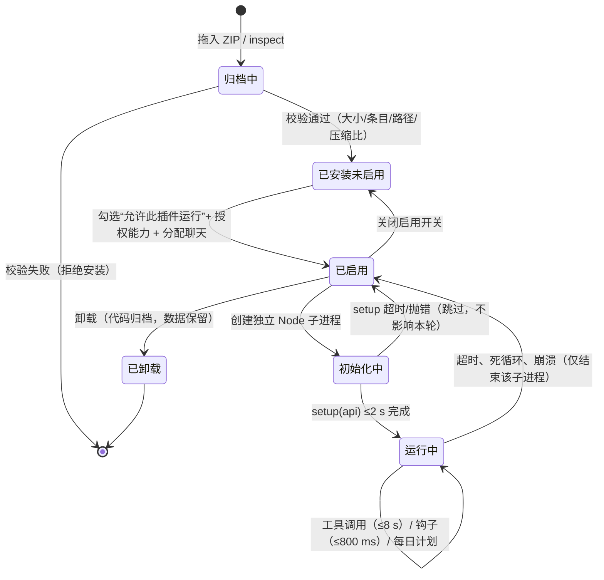
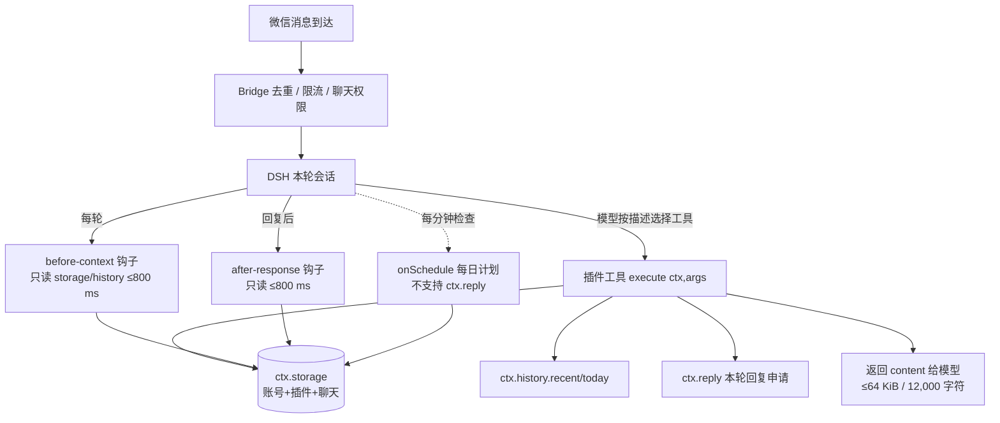

# 架构审查报告（阶段 0 · G0）

| 项目 | 内容 |
| --- | --- |
| 模块 | 01 阶段 0：仓库与宿主审查 |
| 依赖版本 | 00-统一契约 v1.7.2 |
| 审查日期 | 2026-11-10 |
| 审查对象 | `WeChatAgent-plugin-api-v2.md`（宿主契约文档）、`chat-notes-1.1.0/`、`chat-archive/`、三份参考 ZIP |
| 产物 | 本文件、`host_constraints.md` |
| G0 结论 | **条件通过**：A1–A15 全部有结论；2 项阻塞待裁决（见 §9） |

> 说明：本工作区**不含宿主仓库源码**（无 `src/`、无 `packages/plugin-api/contract.mjs`、无 `.git`）。因此本轮证据以「宿主契约文档 + 可运行示例插件 + 真实 ZIP 产物」为上限，**没有任何运行期证据**。按 01 §4.2 的定义（"高"必须同时有代码证据与运行证据），本轮最高置信度为**中**。所有需要宿主源码的项记为「待验证」并附检索命令。

---

## 1. 结论摘要

1. 宿主是 WeChatAgent 的 **ZIP / API v2 插件宿主**，插件在独立 Node 子进程运行，入口 `index.mjs`，零 npm 依赖（`WeChatAgent-plugin-api-v2.md:29`、`:171`）。
2. **不存在消息级订阅钩子**：全量只有 `before-context` / `after-response` 两类钩子。前者只读存储，后者可改写/抑制本轮文本（需 `reply` 权限），**两者都不得写 storage、联网或发送**（`:159-167`）；按消息路由的只有 `voice-input-v1`、`diary-question-v1` 两项专用能力（`:229-234`），都不是通用文本事件流。
3. 因此状态推进是**惰性**的，只能发生在 `observe` / `tick` 工具内或 `onSchedule` 每日计划里；`before-context` 不能推进、不能写 storage。
4. **存储层没有事务 API**：`ctx.storage` 只有 `get/set/delete` 三个单键操作（`:139-141`）；04 §5.3.1 已按"两阶段 + 提交标记"设计 WAL + 补偿，与该事实一致，**不需要契约修订**。其成立前提是"同一 `character_id` 的读-算-写被串行化"，对应债务 D-3。
5. 体积与时间预算充裕：参考包最大 25 KiB（17 条目），核心预计 < 1 MiB；工具 8 s 预算下引擎可占 5 s。**推荐内嵌模式（4.50 分 vs 远程 3.00 分）**。

---

## 2. 插件生命周期



依据：安装/启用/更新/卸载语义见 `:7-10`、`:254-256`；子进程与故障隔离见 `:171`、`:124`；`activate()` 只在启用后执行一次见 `:168`。

---

## 3. 调用链



依据：工具调用与结果上限 `:122-124`；钩子注入点 `:165-167`；每日计划 `:221`；`ctx.storage` 隔离 `:139-141`、`:148`；`ctx.reply` `:154`。

**对引擎的直接含义**：`advance` 只能在 `T`（工具）内执行；`H1/H2` 只能读已落库的 `state_summary`；`S` 只能做维护型推进（如 `tick`），不能发送消息。

---

## 4. 证据表

| 编号 | 结论 | 证据（`路径:行号` 或命令） | 置信度 |
| --- | --- | --- | --- |
| E01 | 入口固定 `index.mjs`，ESM，无 `package.json`，禁止 `node_modules` | `WeChatAgent-plugin-api-v2.md:29`；`chat-notes-1.1.0/index.mjs:1` 为 `export function setup(api)` | 中 |
| E02 | 未知顶层字段（`entry`/`enabledByDefault`/`scripts`）直接拒绝 | `WeChatAgent-plugin-api-v2.md:78` | 中 |
| E03 | ZIP 上限 8 MiB / 解压 16 MiB / 单文件 4 MiB / 128 条目 / 8 层 / 压缩比 ≤500 | `WeChatAgent-plugin-api-v2.md:33`；实测参考包见 §8 | 中 |
| E04 | 宿主提供校验打包脚本，先校验再生成 ZIP | `WeChatAgent-plugin-api-v2.md:245`、`:291` | 待验证（脚本不在工作区） |
| E05 | 插件是独立 Node 子进程，V8 旧生代堆 96 MiB，非 OS 沙箱 | `WeChatAgent-plugin-api-v2.md:171` | 中 |
| E06 | `setup()` 必须 2 s 内完成，初始化禁止联网/常驻任务 | `WeChatAgent-plugin-api-v2.md:86` | 中 |
| E07 | 工具单次 ≤8 s，每轮最多 3 次；结果 ≤64 KiB，给模型 ≤12,000 字符 | `WeChatAgent-plugin-api-v2.md:122-124` | 中 |
| E08 | `before-context` 额外收到 `ctx.message`，返回 `{context}` 最多采用 4000 字符 | `WeChatAgent-plugin-api-v2.md:165` | 中 |
| E09 | 钩子只允许读 storage/history；每类钩子每插件 800 ms，一类总预算 2 s | `WeChatAgent-plugin-api-v2.md:167`；示例只读实现 `chat-archive/index.mjs:134-146` | 中 |
| E10 | `ctx.storage` 按「账号+插件+聊天」隔离，单账号单插件合计 256 KiB，键名 1–64 位 `[A-Za-z0-9_-]` | `WeChatAgent-plugin-api-v2.md:139-141`、`:148` | 中 |
| E11 | **存储无事务/批写 API**，只有单键 `get/set/delete`，值为 JSON | `WeChatAgent-plugin-api-v2.md:139-141` | 中 |
| E12 | `ctx.fetch` 仅公开 HTTPS GET，`maxChars` 256–32000，`timeoutMs` 100–7000，拒绝本机/内网 | `WeChatAgent-plugin-api-v2.md:152` | 中 |
| E13 | `ctx.reply` 每轮 ≤3 条、合计 ≤12,000 字符，且只是"本轮回复申请" | `WeChatAgent-plugin-api-v2.md:145`、`:154` | 中 |
| E14 | 无消息级订阅；按消息路由的能力仅 `voice-input-v1` / `diary-question-v1` | `WeChatAgent-plugin-api-v2.md:229-234` | 中 |
| E15 | `onSchedule` 由宿主每分钟检查，动作/计划**不支持** `ctx.reply`，最长 35 s | `WeChatAgent-plugin-api-v2.md:200`、`:202`、`:221` | 中 |
| E16 | `ctx.now` 是"本次调用开始的毫秒时间" | `WeChatAgent-plugin-api-v2.md:136`；示例用 `ctx.now \|\| Date.now()`（`chat-archive/index.mjs:139`） | 中 |
| E17 | `ctx.actor` 只有 `{id}`，**不是管理员授权凭据** | `WeChatAgent-plugin-api-v2.md:134` | 中 |
| E18 | 插件崩溃/超时只结束该子进程，其他功能继续；同插件其他聊天并发调用可能失败 | `WeChatAgent-plugin-api-v2.md:124`、`:299` | 中 |
| E19 | 更新保持 id、递增 version，旧代码归档、数据保留、插件停用 | `WeChatAgent-plugin-api-v2.md:254` | 中 |
| E20 | 持久数据落盘路径 `state/plugins/<账号作用域哈希>/<插件id>/data.json`，插件无法直接寻址 | `WeChatAgent-plugin-api-v2.md:264` | 中 |
| E21 | 设置/工具 Schema 为受限子集，嵌套 ≤12 层，支持 `secret:true` | `WeChatAgent-plugin-api-v2.md:80-82` | 中 |
| E22 | 开发环境 Node 版本 | `node --version` → `v24.19.0` | 高 |
| E23 | 工作区非 git 仓库，未修改任何宿主文件 | `git status` → `fatal: not a git repository` | 高 |

---

### 4.1 A1–A15 逐项结论

| 编号 | 审查项 | 结论 | 证据 | 置信度 |
| --- | --- | --- | --- | --- |
| A1 | 插件加载入口与目录解析 | 固定 `index.mjs`（ZIP 根或单层目录），无 `package.json`；由宿主加载器按清单解析 | E01、E02 | 中 |
| A2 | 生命周期 | 安装 → 未启用 → 启用 → 初始化（`setup` ≤2 s）→ 运行 → 停用/卸载；更新即"归档旧码 + 停用 + 待重启用" | §2 图、E19 | 中 |
| A3 | ZIP 校验 | 8 MiB / 16 MiB / 4 MiB / 128 条目 / 8 层 / 压缩比 500；拒绝绝对路径、`..`、设备名、ADS、重名 | E03 | 中 |
| A4 | 子进程模型 | 独立 Node 子进程，V8 旧生代 96 MiB；超时/崩溃只结束该子进程 | E05、E18 | 中 |
| A5 | `api` 方法与版本判定 | `api.apiVersion === 2`；`registerTool` / `registerAction` / `onSchedule`；`ctx` 方法清单见 `:139-152` | E07、E10、E12、E13、E15 | 中 |
| A6 | 工具调用链 | 模型按 `description` 选择 → `execute(ctx,args)` → 返回 `{content,isError}` → 结果 ≤64 KiB / 12,000 字符 | §3 图、E07 | 中 |
| A7 | 钩子调用链 | `before-context` 注入 `{context}`（≤4000 字符）；`after-response` 可改写 `{text}`；每类 800 ms / 总 2 s；只读 | E08、E09 | 中 |
| A8 | 存储实现 | 按「账号+插件+聊天」隔离的 KV（底层 `data.json`），单账号单插件 256 KiB，只有单键 `get/set/delete`，**无事务** | E10、E11、E20 | 中 |
| A9 | 消息事件来源 | **无消息级订阅**；只能由模型按需调工具，钩子只读，`onSchedule` 粒度 1 分钟且不能回复 | §5、E14、E15 | 中 |
| A10 | 聊天范围授权 | `ctx.chat` 只含当前聊天，无跨聊天目标参数；控制台按聊天分配（`chats:null` 为全部） | `:133`、`:280` | 中 |
| A11 | `ctx.now` 语义 | 本次调用开始的毫秒时间；同一次 `execute` 内恒定，跨调用不保证单调 | E16 | 中 |
| A12 | 日志落盘 | 插件自身无日志 API；DSH 侧日志路径由宿主决定，插件不可读 | 文档未提供 | 待验证 |
| A13 | 更新机制 | 运行中可替换 ZIP，空闲时或下一轮自动加载；旧代码归档、数据保留、权限清空、插件停用 | E19、`:31` | 中 |
| A14 | 失败处理 | 工具抛错/超时/崩溃只结束子进程，本轮继续；同插件其他聊天并发调用可能失败 | E18 | 中 |
| A15 | 可复用工具函数 | 工作区无宿主源码，**无**可直接复用的时间/校验/日志/哈希工具；仅可复用示例写法 | §6 | 高 |

---

## 5. A9 专门章节：消息级触发能力

### 5.1 结论

**不存在通用的"消息到达即调用插件"订阅机制。** 依据：

- 宿主只定义两类钩子（`before-context` / `after-response`），均为"每轮会话"粒度，不是"每条消息"粒度，且都禁止写 storage（`:167`）。
- 按消息路由的只有两个专用能力：语音（`voice-input-v1` → `transcribe`）与日记询问（`diary-question-v1` → `ask`），由宿主识别后调用固定动作（`:229-234`）。两者都需要专门声明且每聊天只能一个插件占用，不能用于通用文本事件。
- 工具由模型按 `description` 选择，非必达（`:12`："工具由当前 DSH 模型按描述选择"）。

**补充事实（第二轮核验修正）**：宿主确实提供 `onSchedule` 每日计划，由宿主**每分钟**检查（`:221`），可以承载分钟级推进，但不支持 `ctx.reply`（`:202`）。13 §1.1 主动禁止注册定时器，这是**我方自我约束，不是宿主能力缺失**。若未来需要分钟级推进或准点补发，应作为契约变更评估（会改动 11 的 `queue_until_awake` 与 07 的 `long_silence` 精度口径），不在 v1.7.2 内实施。

### 5.2 对引擎的四条影响（01 §2.2 要求）

| 编号 | 影响 | 本项目的应对 |
| --- | --- | --- |
| I-1 | 状态推进是**惰性**的：每次工具调用按 `elapsed` 补算，不是实时 | 02 的 `coarseForward` + 07 的 `elapsed` 衰减即为此设计；`observe` 必须把 `now` 与 `last_tick_at` 的差值完整补算 |
| I-2 | **无延迟发送能力**：`ctx.reply` 只作用于本轮，`schedule` 不支持 `ctx.reply` | 11 的 `queue_until_awake` 必须降级为"唤醒后首次推进补发一条摘要"，不得承诺准点送达；`delivery.policy` 只作建议，不构成发送保证 |
| I-3 | `before-context` **只读**，不能推进、不能写 storage | 13 的钩子实现只能读 `state_summary` 快照并格式化；任何 `advance` 都必须在 `observe`/`tick` 内完成 |
| I-4 | `long_silence`（>6 h）精度受限：只能在下次工具调用或管理员 `tick` 时被发现 | 07 的检测点写在 `elapsed` 补算里；报告与 UI 不得声称"实时检测"；实际发现时间 = 上次推进 + 用户下次触发 |

### 5.3 待验证项

若宿主存在未文档化的消息事件（例如新版本新增 `onMessage`），需以源码确认。检索命令：

```powershell
# 在宿主仓库根目录执行
Select-String -Path .\**\*.mjs,.\**\*.ts -Pattern "onMessage|message-received|'message'|before-context" -List
```

命中 `onMessage` 则必须重评 I-1/I-3/I-4；未命中则本结论升级为"高"。

---

## 6. 可复用代码清单

工作区没有宿主源码，**没有可直接 import 的宿主工具函数**。可复用的只有示例插件的模式（复制思路，不复制文件）：

| 来源 | 可复用点 | 用途 |
| --- | --- | --- |
| `chat-notes-1.1.0/index.mjs:1-31` | `registerTool` + `ctx.storage` 读改写的最小闭环 | 13 的 `observe` 骨架 |
| `chat-archive/index.mjs:134-146` | 钩子内"只读 + 长度预算 + 过期判断"的写法 | 13 的 `before-context` 注入 |
| `chat-archive/index.mjs:128-131` | `onSchedule` 调用同一内部函数的写法 | 13 的 `tick` 兜底 |
| `chat-archive/plugin.json` | `permissions` / `requiresHostFeatures` / `schedule` 组合样例 | `plugin.json` 编写 |

---

## 7. 与来源文档不一致之处（编号化冲突清单）

每条冲突**逐字引用**两处原文。

### C-01｜`ctx.actor.role` 不存在（实质冲突，影响 13）

- 原文 A（`13-WeChatAgent插件适配层.md:219`）：<br>
  > `bind_primary` … 权限列：`` `ctx.actor.role === 'admin'` ``
- 原文 B（`WeChatAgent-plugin-api-v2.md:134`）：<br>
  > `ctx.actor` ｜ `{id}`，当前批次可识别的真实微信发送者；无法确认时为空字符串。它不是管理员授权凭据。
- 冲突：`ctx.actor` 只有 `{id}`，**没有 `role` 字段**，该判定恒为假，`admin` 工具永久 `UNAUTHORIZED`。
- 裁决（已执行，见 v1.7.2）：改为 `settings.adminActorIds` 白名单（存 `sha256(wxid)` 前 12 位），未配置或未命中一律 `UNAUTHORIZED`。

### C-02｜"查宿主管理员配置"无对应接口（实质缺口，影响 13）

- 原文 A（`13-WeChatAgent插件适配层.md:89`）：<br>
  > `event_type` / `relationship_tag` 只取 00 §2.3 / §2.4 枚举；`state` 只读；`tick` 仅管理员可用，`ctx.actor` **不是**授权凭据，必须查宿主管理员配置，无法确认时 fail-closed 拒绝。
- 原文 B（`WeChatAgent-plugin-api-v2.md:130-148`）：`ctx` 能力表只列 `apiVersion` / `chat` / `actor` / `sessionId` / `account` / `now` / `config()` / `signal` / `storage` / `actorStorage` / `history` / `fetch` / `reply` / `audio`，**没有任何读取宿主管理员清单的方法**。
- 冲突：A 要求的"宿主管理员配置"在 B 中不存在。
- 裁决（已执行）：管理判定只依赖插件自身 `settings.adminActorIds`，不读宿主配置；空白名单 = 全部拒绝（fail-closed）。

### C-03｜`README.md` 必需 vs 建议（口径差异，非冲突）

- 原文 A（`13-WeChatAgent插件适配层.md:4.1` 包结构表）：`README.md` ｜ 是（必需）｜ 面向安装者…
- 原文 B（`WeChatAgent-plugin-api-v2.md:24`）：`README.md`        建议，面向安装者的用法
- 裁决：保持 13 更严（必需），不视为冲突。

### C-04｜注入上限 800 vs 4000（无冲突）

- 原文 A（`13-WeChatAgent插件适配层.md:98`）：`before-context` 的注入上限取 `min(behaviorContextMaxChars, 1500)`。
- 原文 B（`WeChatAgent-plugin-api-v2.md:165`）：返回 `{context:string}` 添加当轮资料，最多采用 4000 字符。
- 裁决：800 ≤ 1500 ≤ 4000，我方主动收紧，不冲突。

> **已撤销的冲突项**：初稿 C-03 曾称"04 声明 `transaction(fn)` 提供多键原子写"，与原文不符——`04-持久化与事件幂等.md:134` 明确写着"宿主只保证单键读写完整，多键之间没有原子性。因此固定为'两阶段 + 提交标记'"，并给出 W1–W8 与 7 个崩溃点。该项不是冲突，转为债务 D-3（串行化前提验证），不改 00、不改 04。

---

## 8. 体积实测（参考包 + 本项目预算）

阶段 0 尚无 `lib/**`，无法测本项目包。下列为真实参考包实测（命令见 `host_constraints.md` §4），用于验证打包链路与预算余量：

| 包 | ZIP 大小 | 条目数 | 解压后合计 | 最大单文件 |
| --- | --- | --- | --- | --- |
| `chat-notes-1.1.0.zip` | 5,766 B | 9 | 8,723 B | 1,855 B |
| `chat-archive-0.1.0.zip` | 8,356 B | 9 | 17,031 B | 5,199 B |
| `fish-notebook-module-20261109.zip` | 25,329 B | 17 | 43,864 B | 8,043 B |

本项目预算（波次 1 结束后实测并回填）：`plugin.json` ≤8 KiB、`index.mjs` ≤80 KiB、`lib/**` 压缩前 ≤1.5 MiB、ZIP 内 ≤1.0 MiB。参考包与本预算相差约 40 倍以上，体积风险低。

---

## 9. G0 判定

| 条件 | 状态 |
| --- | --- |
| A1–A15 全部有结论 | 通过（A9 见 §5，全部 15 项已闭环） |
| 关键项 A1/A3/A4/A7/A8/A9 置信度 ≥ 中 | 通过（均为"中"） |
| 8 MiB 限制有代码证据 | **未通过（已登记为 D-1）**：仅有文档证据（`:33`），无宿主源码行号 |
| 消息触达能力有明确结论 | 通过：**无**（§5）；`onSchedule` 为主动放弃，非能力缺失 |
| 延迟发送/队列有能力结论并写明 11 的降级 | 通过：**无延迟发送**（I-2） |
| `long_silence` 精度与偏差来源已写明 | 通过（I-4） |
| 决策矩阵打分完成、推荐明确 | 通过：内嵌 4.50 / 远程 3.00 |
| 体积预算表实测值已填写 | **部分（已登记为 D-2）**：参考包已实测；本项目包待波次 6 回填 |
| 未修改宿主仓库任何文件 | 通过（形式说明）：工作区**不是 git 仓库**，`git status` 无法执行；已确认本轮只新增 `architecture_audit.md` 与 `host_constraints.md` 两份文档，未触碰 `WeChatAgent-plugin-api-v2.md`、`chat-notes-1.1.0/`、`chat-archive/` 及任何 ZIP |

**判定：条件通过（G0-conditional）。** 债务三笔，全部登记如下。

### 9.1 债务登记

| 编号 | 债务 | 关闭时机 | 验证方式 |
| --- | --- | --- | --- |
| **D-1** | 8 MiB / 子进程 96 MiB / 钩子 800 ms / 存储 256 KiB 的**代码行号**证据 | 拿到宿主仓库后（不阻塞波次 1） | 在 `packages/plugin-api/contract.mjs`、`scripts/pack-plugin.mjs`、`scripts/plugin-host-check.mjs` 中定位常量；仓库地址：`https://github.com/sourcepro5/WeChatAgent` |
| **D-2** | 本项目包体积实测回填 | 波次 6 打包后 | `pack-plugin.mjs` 输出 + `host_constraints.md` §4 的回填命令，替换参考包数值 |
| **D-3** | **插件子进程是否长驻、是否可能多进程并存**（02 的 `createMutex` 与 04 的 WAL 串行化前提） | ✅ **已关闭（2026-11-10，源码级）** | `packages/plugin-api/process.mjs` 的 `PluginProcess.start()` 只 `fork('./worker.mjs')` 一次，后续 `call()` 全部复用 `this.child`；`worker.mjs` 是单 `process.on('message')` 长驻循环。→ 单长驻 worker，`createMutex` 进程内成立，04 不需要 `tx_id` 槽位。证据与残余风险见 `host_constraints.md` §9 |
| **D-4** | 04 §5.3.1 的 `tx_journal` 字段表缺 `evlog_event_ids`（实现已需要：回滚要精确定位本次追加的日志项） | ✅ **已关闭（2026-11-10，G4 回填）** | 04 §5.3.1 的 `tx_journal` 字段表补 `evlog_event_ids`（理由："回滚需精确定位本次追加的 `evlog` 条目，仅靠版本号会误删同版本其他事件"）；W3/W5 写入项同步；新增规则"字段缺失或损坏 → 保守放弃删除并写 `meta.recovery_required`"；§8 S22 改为按 `evlog_event_ids` 精确删除，新增 S38 覆盖字段缺失；`repository.mjs` 实现已与之一致，无需改码 |
| **D-5** | 账号级 256 KiB 配额在 chat-scoped 存储下**不可测量**：插件只能看到本聊天五个键，多个聊天共享"账号 + 插件"上界，无法读取他人占用 | ✅ **已复核登记（2026-11-10，v1.7.9）** | 当前安全性由**单写者不变式**保证（13 §5.5：只有 `primary_chat_id` 可写，非主聊天 `saveState` → `DEGRADED`、`appendEvent` 丢弃、`transaction` → `DEGRADED`），账号占用 = 主聊天占用 ≤84 KiB（04 §5.2 单项硬上限之和）<256 KiB；`plugin-storage` 另做单键硬上限写前校验。关闭条件：启用账号级作用域时必须新增账号级预算协调（跨聊天合计 ≤224 KiB 停止写入），否则 256 KiB 会被静默突破。Q2（`set` 是否整文件重写 `data.json`）同样以单写者作为当前唯一缓解手段（见 `host_constraints.md` Q2） |
| **W3-1** | `event.intensity` 缺口 → 00 §7.3 的 0.12 高严重度档实际不可达（协调器与 09 的 `severe` 恒 false） | **G3 前裁决**（波次 3 开工前） | 二选一：**A（推荐）** 07 在 `ModuleResult.derived` 输出 `event_intensity`（00 §4.2 白名单 +1 键，契约变更，07/02 各改一处，09 §5.3 同段写明）；**B** 00 §7.3 注明"v1 仅在事件显式携带 `intensity` 时生效"，07 输出列为 v2。待总控批准后落地 |
| **W3-2** | Node 版本矩阵只有 v24.19.0 证据（`Intl` 时区数据与 `node --test` 行为跨版本有差异） | **G6 前** | 发布前在 v20 与 v22 各跑一次全量，版本号/pass/fail/失败文件写入 `docs/test_report.md`；v20 报错优先改测试与验收命令，不改实现 |
| **W3-3** | `tests/fixtures/assembly.shape.json` 是 05–11 §4.2 的契约镜像，不是测试私有文件 | **G6 前**（修订规则即刻生效） | 任何模块修订自己的 §4.2，必须在**同一波次**更新 fixture 并重跑 `_assembly.test.mjs`；14 §8 新增 T21 引用该 fixture，防止"下游改文档、上游没改装配"穿过 G6 |
| **W4-1** | 00 §7.3 的 `0.12` 高严重度档在 v1 集成路径**不可达**：02 的 chunk 循环结束时 `t === effective_now`，事件阶段 `dt=0`，09 的惯性来源乘 `alpha` 后为 0，`delta_raw` 只剩噪声；`severity_high` 又只在事件阶段为 true | ✅ **已关闭（2026-11-10，G4 裁决 A）** | 00 §7.3 加"v1 可达性说明"：`0.12` 为防御性上限，事件当轮 `dt=0`、冲量经 `stress` 通道在后续 chunk 释放，实际单步上限为 `0.06`；`derived.event_intensity` 保留（09 判 `severity_high` 与未来扩展）。否决 B（事件阶段用总 `elapsed` 作 `dt`，会重复计入时间）与 C（新增 `impulse` 来源，属 v2 契约变更） |
| **W4-2** | W4-1 的连带断言：15 §4.2 E04 与 13 §5.9 仍按"事件当轮情绪立即变化"书写 | ✅ **已关闭（2026-11-10，随 W4-1 落地）** | 15 E04 改为"`stress.level` 不升；后续 ≥1 个 chunk 推进后 `behavior_context.affection_expression` 不低于事件前"；13 §5.9 注明 `observe` 返回的 `state_summary.mood` 是事件前的值，DSH 不得据此判断"角色情绪未变化" |
| **W5-1** | 11 §5.5 的合并结果没有字段承载：`delivery` 无 `merged_count`，也无"折进哪条"；11 无状态、队列在 13 手里 → D12 在集成路径无法实现，13 只能复制规则重扫窗口 | ✅ **已关闭（2026-11-10，G4 后裁决 A 精简版，v1.7.8）** | 00 §12.4 的 `delivery` 增加可选 `coalesced_into{event_id, conversation_id, earliest_queued_at, merged_count}`，仅合并触发时出现、其余整键省略；11 §5.5 改为"保留最早 `queued_at`（同值取 `event_id` 字典序最小）+ `merged_count = 窗口内同会话 pending 数 + 1`"，`max_urgency` 交 13 维护（11 无 `urgency` 输入）；13 §5.9 加消费规则；15 新增 E07；不动 `inputs`，W3-3 不触发 |
| **W5-2** | 15 的 E04 需要"事件后至少推进 1 个 chunk"的构造方法，否则 `elapsed=0` 时读到事件前 mood，误判 A 方案未生效；E02 断言具体数值会因 mood 滞后而不可预知 | ✅ **已关闭（2026-11-10，随波次 5 落地）** | 15 §4.2 E04 写明构造方法（两条消息间隔 ≥3600 s，或 `observe` 后补一次 `/v1/tick`）；E02 改为范围/枚举断言（`0 ≤ reply_likelihood ≤ 1`、区间属四档之一、`is_mentioned` 只上调不下调） |
| **W5-3** | 14 若写"`intensity=0.8` 的集成事件使 mood 单步变化达 `0.12`"会红（W4-1 裁决 A 后事件当轮 `dt=0`） | ✅ **已登记到 14（2026-11-10）** | 14 §5.3「接口版本兼容」写明：`0.12` 档只由 09 的 M21 单测覆盖，集成层只断言 `derived.event_intensity` 转发到 `inputs.event.intensity`；`delivery` 形状快照须含可选 `coalesced_into`（出现时四键齐全、其余整键省略） |
| **W5-4** | 10 §5.4 原阈值下 09 home（`energy=0.60`、`social_drive=0.55`）直接判 `high`，而 §5.8 第 7 条"精力充沛"文案（`≥0.70/≥0.60`）不命中——两个表不一致；`normal` 在稳态下几乎不出现，只在过渡态出现 | ✅ **已关闭（2026-11-10，W5-4 裁决，v1.7.9）** | §5.4 `high` 进入阈值上调至 `energy ≥ 0.62 且 social_drive ≥ 0.58`、保持 `0.57/0.53`（差 0.05 与滞回一致）；home 落 `normal`；§5.8 表后注明"第 7 条文案与 `high` 进入阈值不要求重合"；新增 B17 钉死 home → `normal`；B03 仍绿（保持条件 0.57/0.53 覆盖 0.58↔0.62） |
| **W5-5** | `inputs.event === null`（纯时间推进）原实现返回 `deliver_now`——隐性契约：没有消息可"立即交付"，12 的 `/v1/tick` 响应会让调用方误以为有交付待处理 | ✅ **已关闭（2026-11-10，W5-5 裁决，v1.7.9）** | 11 §5.3 新增规则 0 短路：`silent_ignore` + `reason_codes=['no_event']`；`no_event` 排 §5.8 第 1 位、与其余码互斥；`wake_cost` 仍按 `urgency=0` 计算输出；13 §5.9 补消费规则（不入队、不写 evlog、不触发 DSH）；新增 D18–D20 |
| **W6-1** | 13 §5.4 的"单次工具 ≤20 次"写于 `ensureReady` 淘汰之前；实际 `observe` 稳态 19–21 次、首轮淘汰最坏 ≤24 次，硬上限已超 | ✅ **已关闭（2026-11-10，W6-1 裁决 A）** | 改为一律遵守 00 §11.0 / 04 §5.3 的 **≤40 次**事务上限，13 不再有第二套数字；`observe` 19–21、最坏 ≤24 写进 §5.4；P13 断言改 ≤40；§6 的"淘汰后重试"改为"本次 `DEGRADED` + `STORAGE_OVER_BUDGET`、下次 `ensureReady` 淘汰"（复用只读路径同码，不新增码） |
| **W6-2** | `DEGRADED` 在 00 §9.2 是 200 + `retryable:true`，而 12 §4.3 说 `error.code` 一律来自映射表——若走 `error` 分支即 `ok:false` + 200，自相矛盾 | ✅ **已关闭（2026-11-10，W6-2 裁决，P2-1）** | 00 §9.2 加注：`DUPLICATE_EVENT` / `CLOCK_REGRESSION` / `DEGRADED` 一律走成功信封 `{ok:true,data}`（分别由 `data.duplicate`、`data.diagnostics.warnings` 表达），`error` 分支永不出现这三个码；12 §5.10 加"200 类码不产生 `error`"注记 |
| **W6-3** | 14 §5.6 覆盖率门禁只含 `lib/core` / `lib/modules`，`lib/storage`（已 1000+ 行）与待写的 `lib/api` / `lib/adapter` 不在统计内 | ✅ **已关闭（2026-11-10，W6-3 裁决，P2-2）** | 14 §5.6 补：`lib/storage` 行覆盖 ≥80%、`lib/api` ≥75%、`lib/adapter` ≥75%（低于 core/modules 因 I/O 与防御分支多）；属统计范围补全，不是新增功能要求 |
| **W6-4** | 16 §3.2 的 trace 无 `delivery`，SIM05 无法展示"折叠了几条" | ✅ **已关闭（2026-11-10，W6-4 裁决，P2-3）** | 16 §3.2 trace 每行加可选 `delivery: {policy, coalesced_merged?}`；`coalesced_merged` 取 `coalesced_into.merged_count`，无合并时整键省略；16 只读不消费；不动 00 |
| **P1-1…P1-5**（12 开工前） | ① `reset_state` 的种子语义未定；② `transaction(signal)` 在 W7 后 abort 会撤销已提交事务；③ `manual_cycle_correction` 的 `anchor_at` 位置未定；④ `details.preview` 在成功信封中不存在；⑤ §5.5 重试伪代码调 `saveState`，绕过单事务 | ✅ **已关闭（2026-11-10，v1.7.11）** | ① 04 §6：`reset_state` 必须传 `prevSeed`，只有 `reset_seed` 重派生；② 04 §5.3 / 00 §11.0：`signal` 检查限于 W1–W6，W7 提交后忽略，S40/S40b 双用例；③ 12 §4.1/§5.8：`payload` 顶层嵌套、按 operation 分支校验；④ 12 §5.7 删 `details.preview`，只留 `data.dry_run`；⑤ 12 §5.5 改为"重跑整个 `repo.transaction`"，顺序 `putState → appendEvent → appendIdempotency`，A12 拆 A12a/A12b |

**B2（C-01/C-02 管理员授权冲突）已在 v1.7.2 关闭**，不再是阻塞项：

- `13` §5.9 的判定改为 `sha256(ctx.actor.id)` 前 12 位命中 `settings.adminActorIds`；
- 13 §4.3 新增 `adminActorIds` 设置项（默认空 = 全部拒绝）；
- 13 的 P05 改为两条用例（空白名单拒绝 / 命中放行）；
- 13 §5.5 与 15 的运维章节补 bootstrap 顺序说明。

**放行路径**：

```text
现在：G0 条件通过（D-1/D-2/D-3 已登记；B2 已关闭）
  ↓
波次 1：02 + 03 并行（不依赖任何未决项）
  ↓
波次 2 前：关闭 D-3，否则 04 不开工
  ↓
波次 3–5：正常推进
  ↓
波次 6 前：关闭 D-2（体积回填）
```

---

## 10. 待确认问题清单

| 编号 | 问题 | 验证方法 | 影响 |
| --- | --- | --- | --- |
| Q1 | 宿主是否真的没有消息级事件 | §5.3 的检索命令 + 宿主仓库 `src/` 全量检索 | A9 结论、11 交付策略 |
| Q2 | `ctx.storage` 的 `set` 是否整文件重写、并发写是否互相覆盖 | 宿主 `state/plugins/*/data.json` 写入代码 + 并发测试 | 04 事务实现 |
| Q3 | 同一插件的多个聊天是否并发调用同一子进程 | 宿主 worker 调度代码 | 02 `createMutex` 是否足够 |
| Q4 | 插件子进程是否常驻（一次 `advance` 内可复用 `RandomProvider`） | 宿主 worker 生命周期代码 | 03/16 的 `fromPersisted` 复用策略 |
| Q5 | `state/plugin-documents` 是否可用于大对象（`evlog` 外置） | `ctx.documents` 配额与路径 | 04 容量方案（非必需） |
